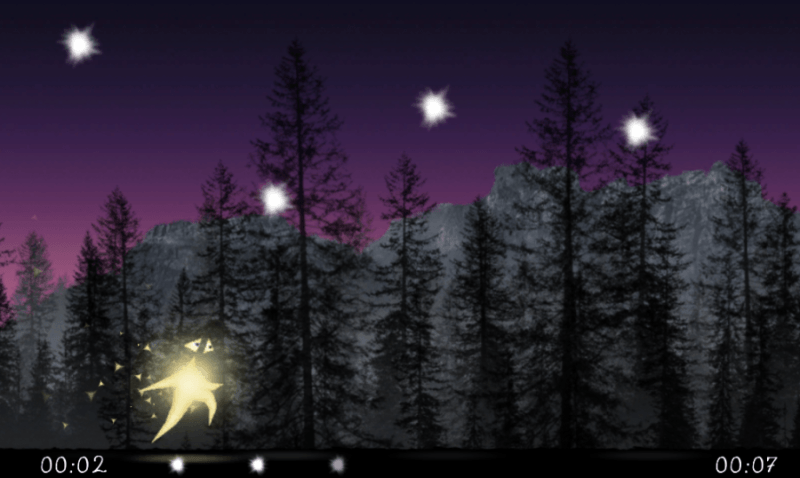
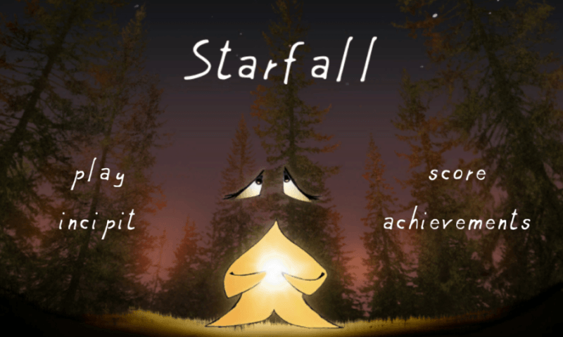

# Starfall

**Sei una stella caduta sulla Terra: raccogli la luce per tornare a casa.**

### [▶ Gioca ora sul web](https://imaginesoftware.it/starfall-play/)

Gratis, nel browser, su smartphone, tablet e PC. Nessuna installazione, nessuna pubblicità, nessun tracciamento.



Ti ritrovi in una selva oscura in cerca della via per risalire verso casa. Sei priva di energie: ti servono le luci per recuperare le forze e riuscire a volare. Durante il cammino, però, i buchi neri cercheranno di assorbirti, e se inglobi troppo buio la tua capacità di volare si riduce.

**Starfall** è un gioco a scorrimento orizzontale il cui mondo evolve nel tempo, sviluppato in un weekend insieme a [Marco Oppici](https://www.linkedin.com/in/marco-oppici-b43471187), che ha creato gli sfondi in parallasse dalle sue fotografie e ha disegnato e animato la stella. La storia completa è sulla [pagina del progetto](https://imaginesoftware.it/open-source-projects/starfall).

## Caratteristiche

- Un livello infinito a difficoltà crescente
- Tre elementi di sfida: luci catturate, tempo di volo, tempo di gioco
- Colonna sonora originale, composta dallo sviluppatore
- Disegni d'autore e composizione grafica con fotografie
- Una breve, ma significativa storia
- Ottimizzato per la batteria dello smartphone

## Dietro le quinte

- **Un mondo capovolto una volta sola.** La telecamera ha il perno sul fondo dello schermo: il terreno è lo zero, salire significa coordinate negative. Così la gravità è un valore positivo e l'impulso del volo uno negativo, senza segni invertiti sparsi nel codice. Vedi [`Camera.ts`](Web/src/world/Camera.ts).
- **Una stella che attira la luce.** Quando la stella entra nel raggio d'attrazione, ogni luce colma a ogni frame il 10% della distanza che le separa: un magnetismo morbido che accelera e si aggancia. Vedi [`GoodGem.ts`](Web/src/gems/GoodGem.ts).



## Tecnologie

La versione web, quella pubblicata, è in [`Web/`](Web): [TypeScript](https://www.typescriptlang.org), [PixiJS 8](https://pixijs.com) per la grafica, [Howler.js](https://howlerjs.com) per l'audio, [Navigo](https://github.com/krasimir/navigo) per le pagine, [Vite](https://vite.dev) per la build.

La cartella [`CSharp/`](CSharp) contiene la versione originale in C# con [MonoGame](https://github.com/MonoGame) e [FbonizziMonoGame](https://github.com/FrancescoBonizzi/FbonizziMonoGame), pubblicata a suo tempo sugli store Android e Windows; le animazioni sono state create con [Spriter](https://brashmonkey.com/spriter-pro/). Resta come archivio storico e non è più mantenuta.

## Avviarlo in locale

Serve [Node.js](https://nodejs.org) 20.19 o successivo (lo richiede Vite 7).

```bash
cd Web
npm install
npm run dev
```

Il gioco risponde su `http://localhost:5173/starfall-play/`: il percorso coincide con quello di pubblicazione sul sito. `npm run build` produce la versione statica in `Web/dist`.

## Crediti

- Codice e musica: Francesco Bonizzi
- Sfondi in parallasse dalle sue fotografie, disegno e animazione della stella: [Marco Oppici](https://www.linkedin.com/in/marco-oppici-b43471187)

## Licenza

Codice, grafica e audio sono rilasciati sotto [licenza MIT](LICENSE). I font di terze parti restano sotto le loro licenze: l'elenco è in [`THIRD-PARTY-NOTICES.md`](THIRD-PARTY-NOTICES.md).

Il repository è archiviato: il gioco è concluso e non riceve più sviluppo.

---

Se ti è piaciuto, puoi [offrirmi un espresso](https://www.paypal.com/cgi-bin/webscr?cmd=_donations&business=DTT7P8N3TV7N6&currency_code=EUR&source=url) ☕
